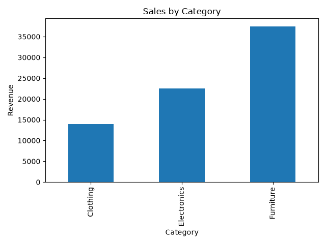
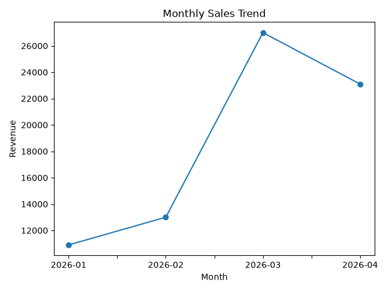
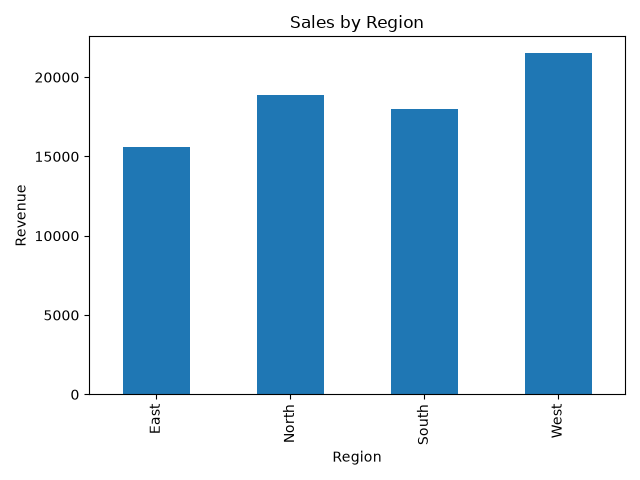

# 📊 Retail Sales Analysis | PostgreSQL & Python

**Turning Retail Sales Data into Actionable Business Insights**

An end-to-end data analytics project using **PostgreSQL, SQL, Python, Pandas, and Matplotlib** to explore retail sales performance, identify trends, and visualize business metrics.

---

## 📌 Project Overview

This project analyzes retail transaction data to understand sales performance across product categories, regions, customers, and time periods. SQL is used to extract and aggregate business data, while Python transforms query results into meaningful visualizations.

The project demonstrates practical skills in **SQL querying, data aggregation, business analysis, and data visualization**.

## 🎯 Business Objectives

- Measure total revenue, orders, and units sold.
- Compare revenue across product categories.
- Analyze monthly sales trends.
- Evaluate sales performance by region.
- Identify top-performing products and high-spending customers.
- Calculate category-wise contribution to total revenue.

## 🛠️ Tech Stack

| Technology | Purpose |
|---|---|
| PostgreSQL | Database management and SQL analysis |
| SQL | Filtering, aggregation, ranking, and business queries |
| Python | Data analysis and visualization workflow |
| Pandas | Data manipulation and grouping |
| Matplotlib | Charts and data visualization |
| VS Code | Development environment |

## 📈 Data Visualizations

### 1. Sales by Category
Compares total revenue generated by each product category.



### 2. Monthly Sales Trend
Shows how sales revenue changes over time.



### 3. Sales by Region
Compares revenue across different geographical regions.



## 🔍 Key Insights & Analysis

The project investigates the following business questions:

- **Revenue Performance:** What is the total revenue and average order value?
- **Category Performance:** Which product categories contribute most to sales?
- **Sales Trends:** How does revenue vary from month to month?
- **Regional Performance:** Which regions generate the highest sales?
- **Product Analysis:** Which products rank highest by revenue?
- **Customer Analysis:** Which customers have the highest total spending?
- **Revenue Contribution:** What percentage of total revenue comes from each category?

These questions help demonstrate how raw transaction data can support business reporting and decision-making. Specific findings should be documented after reviewing the query results.

## 🗂️ Project Structure

```text
retail-sales-analysis/
│
├── sales_analysis.py
├── queries.sql
├── sales_by_category.png
├── monthly_sales_trend.png
├── sales_by_region.png
└── README.md
```

## ⚙️ How to Run

### Prerequisites
- PostgreSQL
- Python 3
- VS Code or another Python editor

### Step 1: Install Python Libraries

```bash
pip install pandas matplotlib psycopg2-binary
```

### Step 2: Set Up the Database

Create a PostgreSQL database named `retail_sales_db`, then create the `retail_sales` table and insert the sample records using the SQL setup provided for this project.

### Step 3: Run the SQL Queries

Open `queries.sql` in pgAdmin's Query Tool and execute the queries to explore the data.

### Step 4: Configure the Database Connection

Update the connection settings in `sales_analysis.py` to match your local PostgreSQL configuration. Keep your database password private and do not commit credentials to GitHub.

### Step 5: Generate the Charts

Run the following command from the project directory:

```bash
python sales_analysis.py
```

The script generates the category-wise sales, monthly sales trend, and regional sales charts as PNG files.

## 📚 SQL Concepts Practiced

- `SELECT`, `WHERE`, and `ORDER BY`
- Aggregate functions: `SUM()`, `COUNT()`, and `AVG()`
- `GROUP BY` and `LIMIT`
- Date formatting and monthly aggregation
- Window functions for percentage contribution
- Revenue calculations and customer/product ranking

## 💡 Skills Demonstrated

**SQL Analysis · PostgreSQL · Python · Pandas · Data Visualization · Business Analytics · Problem Solving**


## 👨‍💻 Author

**Rahul Raigar**

- GitHub: [RAHULRAIGAR](https://github.com/RAHULRAIGAR)
- Portfolio: [Visit My Portfolio](https://rahulraigar.github.io/)

---

*Built to strengthen practical SQL and data analytics skills through hands-on business analysis.*
